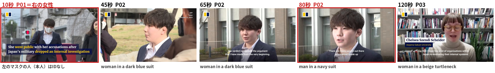
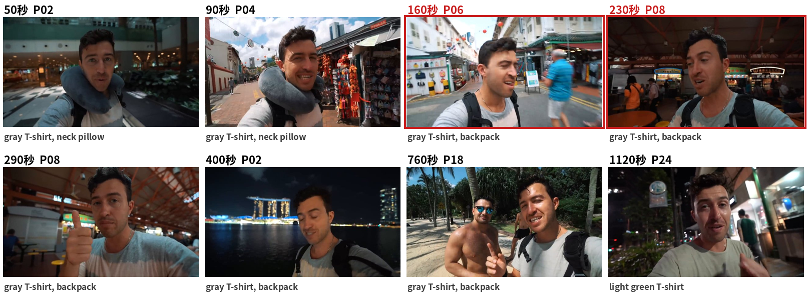

# 2026-10-23 MTG資料: イベント集約（段A・段B）

## 0. 今日のMTGで相談したいこと

1. **段Bで、同じ人が多くのIDに分かれる問題（4.4）。** 今は「よくある見た目（グレーのTシャツ＋リュックなど）」は、直前の人とだけつなぐ規則にしています。そのため、間に別の人が1行入るだけで、同じ人に新しいIDが付きます。規則を緩めるか、記録Agentに前の区間の人物一覧を渡して呼び方をそろえる方向にするかを相談したいです。
2. **集約の役割。** 今の集約は「隣り合う同じ行をまとめる」「同じ人にIDを付ける」だけで、回答の正答率には差が出ていません（第5節）。時間スケールごとのまとめなど、別の働きを持たせる方向でよいかを相談したいです。

## 1. 現時点の結論

- 集約は、記録Agentが書いたイベントの行を、**LLMを使わず、コードの規則だけで** 整理する処理です。2つの段に分かれます。
  - **段A：同じ動作が続く行を1行にまとめる**
  - **段B：同じ人の行に同じID（P01, P02 …）を付ける**
- **うまくいったこと**
  - 区間をまたいで続く同じ動作を1行にできた（ニュースの動画で4行 → 1行）。
  - 記録Agentが「woman」と「man」で書き分けてしまった同じ人を、服と髪で同じIDにできた。
  - 記録Agentが同じ行を120回繰り返したとき、それを1行にできた。
- **うまくいかなかったこと**
  - 1つの行に2人目として書かれた人には、IDが付かない。
  - 場面が切り替わる動画では、同じ人が多くのIDに分かれる（Vlogで主役の男性が6個以上のIDに分かれた）。
  - 長い動画（10秒に1枚）では、段Aがほとんど何もまとめない（83行 → 83行）。
- 回答の正答率は、集約しても変わっていません。

## 2. 集約の全体

```txt
記録Agentが書いた行（区間ごと、時刻付き）
        │
        ▼
 段A：同じ動作が続く行を1行にまとめる      … 行の数が減る
        │
        ▼
 段B：同じ人の行に同じIDを付ける            … 行に P01 などが付く
        │
        ▼
集約後の記録（回答Agentが読む）
```

- どちらの段も、英語の文を **単語の一覧と正規表現** で判定しています。LLMも埋め込みも使っていません。
- 細かい規則（しきい値、単語の一覧、変数）は、[集約の入出力と処理の中身](2026-10-22-event-record-aggregation-io-explainer.md) にまとめています。この資料では、**何をしているか** を実際の例で説明します。

## 3. 段階ごとの動き：ニュースの動画で追う

10/22〜23の実験の出力から、ニュースの動画 `BtaVRhoLpC0`（約3分、5秒に1枚）を使います。五野井里奈さんの裁判についてのニュースで、人の正解（誰がいつ写っているか）を目で作ってあります。

### 3.1 入力：記録Agentが書いた行

記録Agentは、40秒の区間ごとに、時刻付きの行を書きます。全部で19行です（一部）。

```txt
[00:40-00:40] woman in a dark blue suit with short brown hair and a white shirt stands among reporters ...
[00:45-00:50] woman in a dark blue suit with short brown hair and a white shirt speaks to reporters
[01:05-01:15] woman in a dark blue suit with short brown hair and a white shirt speaks outside a building
───── ここで区間が変わる（次の40秒） ─────
[01:20-01:25] man in a navy suit with short brown hair speaks outside a building
[01:30-01:35] man in a navy suit with short brown hair speaks outside a building
[01:40-01:50] man in a navy suit with short brown hair speaks outside a building
```

- 6行とも五野井さんです。
- 区間が変わると、記録Agentは前の区間を見ていないので、呼び方が「woman in a dark blue suit」から「man in a navy suit」に変わっています。

### 3.2 段A：同じ動作が続く行を1行にまとめる

**やること:** 時刻が隣り合う（1枚分の間隔以内）行どうしを比べ、**誰が** と **何をしたか** の両方が十分に近ければ、1行にまとめます。

**判断のしかた（簡単に）:**

1. 文を「誰が（主語）」と「何をしたか（述語）」に分ける。
2. 述語の単語がほぼ同じ（80%以上）で、主語の単語も半分以上同じなら、まとめる。
3. まとめた行は、時刻の範囲を広げ、文はいちばん長い行のものを使う。

**例:**

```txt
[01:05-01:15] woman in a dark blue suit ... | speaks outside a building
[01:20-01:25] man in a navy suit ...        | speaks outside a building   ← 述語が同じ
[01:30-01:35] man in a navy suit ...        | speaks outside a building   ← 述語が同じ
[01:40-01:50] man in a navy suit ...        | speaks outside a building   ← 述語が同じ
          │
          ▼  段A
[01:05-01:50] woman in a dark blue suit with short brown hair and a white shirt speaks outside a building
              （4行をまとめた。性別の語が食い違うので gender_conflict の印を付ける）
```

- 区間をまたいでも、同じ動作が続いていればまとめます。
- この動画では **19行 → 15行** になりました。

### 3.3 段B：同じ人の行に同じIDを付ける

**やること:** 行を時刻順に見て、主語の **見た目**（服とその色、髪の色・長さ、眼鏡、持ち物、服の文字）を取り出し、すでにあるIDの見た目と比べます。

**判断のしかた（簡単に）:**

1. 主語から見た目を取り出す。例：`man in a navy suit with short brown hair` → 服 `suit: navy`、髪 `dark`（brown も black も dark として扱う）、`short`。
2. すでにあるIDと比べる。**食い違い**（髪が long と short、服の色の系統が違う など）が1つでもあれば、つながない。
3. 食い違いがなく、次のどれかに当たればつなぐ。
   - 強い手がかり：服の文字が同じ、または、服が同じで場所の句も同じ（例：`outside a building`）
   - よくある手がかり：服が同じで点数が3以上、かつ、**直前の人の行** で、間に場面の切り替わりがない
   - 直前の人の行と、呼び方が一字一句同じ
4. どれにも当たらなければ、新しいIDを作る。
5. **性別の語（man / woman）は比べない。** 記録Agentが性別を書き間違えることがあるため。

**例:**

```txt
[01:05] woman in a dark blue suit with short brown hair and a white shirt ... → P02（直前と同じ呼び方）
[01:20] man in a navy suit with short brown hair ...                           → P02
        比べた結果: suit の色 navy と dark blue は「dark」で重なる、髪 dark が同じ、
                   場所 outside a building が同じ → 強い手がかりでつなぐ（3点、食い違いなし）
```

### 3.4 出力：集約後の記録

段Aの1行ごとに、中の行に付いたIDを集めたものが、集約後の記録です（一部）。

| 段A | 時刻 | ID | 文 |
| --- | --- | --- | --- |
| A004 | 00:40–00:40 | P02 | woman in a dark blue suit ... stands among reporters ... |
| A005 | 00:45–00:50 | P02 | woman in a dark blue suit ... speaks to reporters |
| A006 | 00:55–00:55 |  | view cuts to a large building ... stone sign ... |
| A008 | 01:05–01:50 | P02 | woman in a dark blue suit ... speaks outside a building |
| A009 | 01:55–01:55 | P03 | view cuts to woman in a beige turtleneck ... bookshelves |

- 人のいない行（建物、看板など）にはIDが付きません。
- 回答Agentは、この表を読んで答えます。

## 4. 実際の出力：うまくいった例・うまくいかなかった例

### 4.1 使った実験（10/22〜23）

| 項目 | 内容 |
| --- | --- |
| データ | LongVideoBench val。4つの動画長のグループから各30本 |
| 記録 | v6g。区間あたり8枚。1枚の間隔は 1 / 2.5 / 5 / 10 秒（長い動画ほど広い） |
| 集約 | 段A v2 → 段B v9 |

以下の例は、このうちニュース（5秒に1枚）、映画解説（2.5秒に1枚）、Vlog（10秒に1枚）から選びました。

### 4.2 うまくいった例①：呼び方が変わっても、同じ人を同じIDにできた（ニュース）

**この図で見る点:** 45秒・65秒・80秒は同じ人（五野井さん）です。記録は「woman in a dark blue suit」と「man in a navy suit」で書き分けていますが、段Bはどれも **P02** にしました。



| 人 | 正解の登場 | 段BのID |
| --- | --- | --- |
| 五野井さん（スーツ） | 00:40〜01:50 | **P02**（6行すべて） |
| Schieder さん（本棚の前） | 01:55〜02:30 | **P03**（2行すべて） |
| 冒頭で並んで歩く女性 | 00:02〜00:22 | P01（4行。ただし 00:30 の行は誤り。4.5） |

**なぜうまくいったか:**

- 性別の語を比べず、服（スーツの色の系統）・髪・場所で比べたため。
- 段Aも、区間をまたいだ4行（01:05〜01:50）を1行にまとめました。

### 4.3 うまくいった例②：同じ行の繰り返しを1行にできた（映画解説）

- 動画 `@movie.explained6-7275653401025826050`（約60秒、2.5秒に1枚）で、記録Agentが60秒の1枚について、同じ行を **120回** 書きました（記録Agentの暴走）。

```txt
[01:00-01:00] man in a blue uniform with short blond hair and white gloves lifts a person on a stretcher while others assist from below
（同じ行が120回）
```

- 段Aは、この120行を **1行** にまとめました。動画全体では **144行 → 25行** です。
- 回答Agentに渡す記録から重複が消えるので、暴走の害は小さくなりました。

### 4.4 うまくいかなかった例①：同じ人が多くのIDに分かれる（Vlog）

**この図で見る点:** 8枚とも同じ男性（Vlogの主役）ですが、段Bは **P02、P04、P06、P08、P18、P24** と、6個のIDに分けました。赤枠の160秒と230秒は、記録の呼び方が **一字一句同じ** なのに、別のIDです。



- 動画 `JDtVwz1R-kI`（シンガポール旅行のVlog、約20分、10秒に1枚）

```txt
[02:40-02:50] man in a gray T-shirt with short dark hair and a backpack talks to the camera ...   → P06（新）
[03:00-03:10] man in a gray T-shirt with short dark hair and a backpack walks into a food market  → P06
[03:20-03:40] woman in a dark blue T-shirt ... and a black apron stands behind a food stall        → P07（新、屋台の人）
[03:50-03:50] man in a gray T-shirt with short dark hair and a backpack talks to the camera ...   → P08（新）← 同じ人なのに別のID
```

**なぜうまくいかなかったか:**

- 「グレーのTシャツ＋リュック」は、**よくある手がかり** として扱っています。別の人を間違えてつながないように、**直前の人の行で、間に場面の切り替わりがないときだけ** つなぐ規則にしました。
- Vlogでは、店の人や景色の行が頻繁に間に入ります。そのたびに「直前の人」が変わるので、同じ呼び方でも新しいIDになりました。
- 逆に、350秒の行（図の400秒の1つ前の行）は、40秒の行と場所の句（`at night`）が同じだったため、強い手がかりとして離れた P02 につながりました。図の400秒の行も、それに続いて P02 になっています。根拠が「夜」だけなので、たまたま合っただけと考えます。
- この動画では、人のIDが **24個** できました。似た呼び方（gray / light gray T-shirt の男性）のIDは10個あり、多くはこの男性だと考えます（全行を画像で確認したわけではありません）。

### 4.5 うまくいかなかった例②：2人目として書かれた人にIDが付かない（ニュース）

**この図で見る点:** 図の10秒（赤枠）で、左のマスクの人が五野井さんです。

```txt
[00:00-00:05] woman in a black coat with long black hair and a yellow face mask walks beside a man in a dark blue suit with short black hair and a white face mask
```

- 記録Agentは、この場面を **右の女性が主語、五野井さんが2人目** の文で書きました。
- 段Bは主語にだけIDを付けるので、この行は右の女性の **P01** になり、五野井さんにはIDが付きません。
- そのため、「五野井さんが最初に出たのはいつか」は、IDからは 00:40 になってしまいます（正解は 00:02 ごろ）。
- さらに、00:30 の画像には五野井さんしか写っていませんが、記録Agentは前の行と同じ「右の女性 and 五野井さん speak outside a building」と書きました。段Bは「直前と同じ呼び方」で、この行も **P01（右の女性）** にしました。記録の誤りが、そのままIDの誤りになった例です。

### 4.6 うまくいかなかった例③：長い動画では、段Aがほとんどまとめない

| グループ | 1枚の間隔 | 記録の行 | 段Aの後 | 減った割合 |
| --- | --: | --: | --: | --: |
| 8–15秒 | 1秒 | 205 | 195 | 5% |
| 15–60秒 | 2.5秒 | 440 | 309 | 30%（大半は 4.3 の暴走） |
| 3–10分 | 5秒 | 1,676 | 1,611 | 4% |
| 15–60分 | 10秒 | 2,954 | 2,772 | 6% |

- 4.4 のVlogでは、**83行 → 83行** で、1行もまとまりませんでした。
- 10秒に1枚だと、ほぼすべての行が1枚だけの行（`[02:40-02:40]` のような行）になり、隣の行とは動作が変わっています。段Aがまとめる「同じ動作が続く行」が、そもそもありません。
- 集約の規則の問題というより、**間隔を広げたことの結果** だと考えます。

## 5. 回答への効果

| グループ | 問 | 記録だけ | 段A | 段A＋段B |
| --- | --: | --: | --: | --: |
| 8–15秒 | 28 | 68% | 64% | 61% |
| 15–60秒 | 30 | 70% | 70% | 63% |
| 3–10分 | 60 | 53% | 53% | 57% |
| 15–60分 | 90 | 60% | 63% | 59% |

（v6g、回答プロンプト a3）

- 差は数ポイントで、問題数のばらつき（±10〜17ポイント）の中に入っています。
- 理由として考えられること:
  - 段Aで減る行が少ないので、回答Agentが読む記録は、集約前とほぼ同じ。
  - 今の長さ（最長でも約130行、約5,000 token）なら、回答Agentは集約しなくても全部を読める。
  - 段BのIDを、回答Agentがうまく使えていない可能性がある（推測）。

## 6. 今回言えること / まだ言えないこと

### 言えること

- 段Aは、区間をまたいで続く同じ動作と、記録Agentの繰り返しを1行にまとめられる。
- 段Bは、性別の語が食い違っても、服・髪・場所で同じ人を同じIDにできる場合がある（ニュース）。
- 段Bは、場面が頻繁に切り替わる動画では、同じ人を多くのIDに分けてしまう（Vlog）。
- 段Bは、2人目として書かれた人にIDを付けない。
- 10秒に1枚の長い動画では、段Aはほとんど行を減らさない。

### まだ言えないこと

- 段Bの分かれ方がどれくらいの割合で起きているか。正解のIDがあるのは数本だけで、LongVideoBenchの240本では数えていない。
- 段BのIDを直せば、回答の正答率が上がるか。
- 集約が役に立つのは、どれくらいの長さや細かさの記録からか。

## 7. 次に進む候補（まだ決定ではない）

1. **段Bの「よくある手がかり」を、直前の人だけでなく、少し前（例：数行前まで）の人とも比べる。** Vlogの分かれは減るが、別の人を間違えてつなぐ危険が増える。
2. **記録Agentに、前の区間の人物一覧（IDと呼び方）を渡す。** 呼び方がそろえば、段Bの規則はもっと単純にできる。
3. **2人目として書かれた人にもIDを付ける。** 今は `others` として取り出しているが、IDの判定には使っていない。
4. **集約に別の働きを持たせる。** 例：IDごとに「この人が出た時間帯」の一覧を作る、時間スケールごとにまとめる。

## 8. 図・生成物

- `figures/2026-10-23-event-aggregation/01-news-person-ids.png`：ニュースの動画の5枚と、段BのID（4.2、4.5）
- `figures/2026-10-23-event-aggregation/02-vlog-person-split.png`：Vlogの8枚と、段BのID（4.4）
- 出典と作り方：`figures/2026-10-23-event-aggregation/manifest.md`

## 9. 参照ファイル

- [集約の入出力と処理の中身（詳しい規則）](2026-10-22-event-record-aggregation-io-explainer.md)
- [イベント書き起こしAgentの資料](2026-10-23-event-transcription-agent-mtg-materials.md)
- [動画長グループ別の試行](../experiments/2026-10-22-lvb-duration-groups.md)
- 生出力（git追跡外）：Workbenchリポジトリ `2026_10_hayashi_pre_study_agent_system_workbench` の `outputs/2026-10-22_23-39-02/v6g/<グループ>/aggregations/`
- ニュースの動画の人の正解：同リポジトリの `experiments/2026-10-21-event-aggregation/ground_truth_ids.json`
