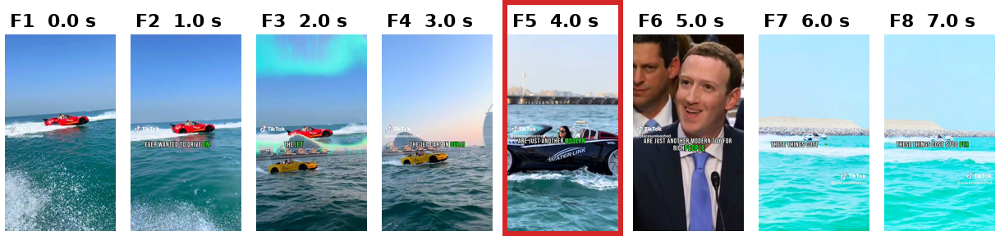
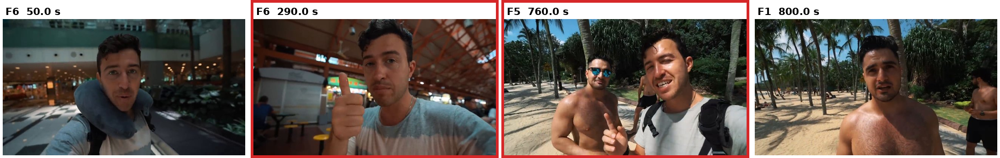
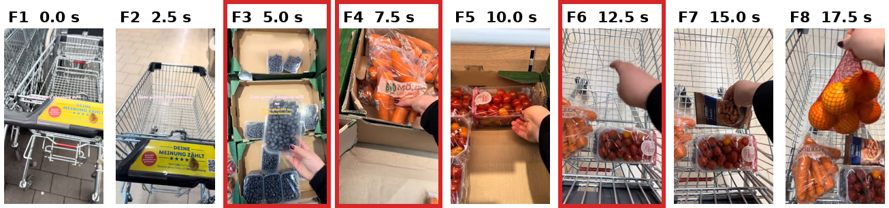
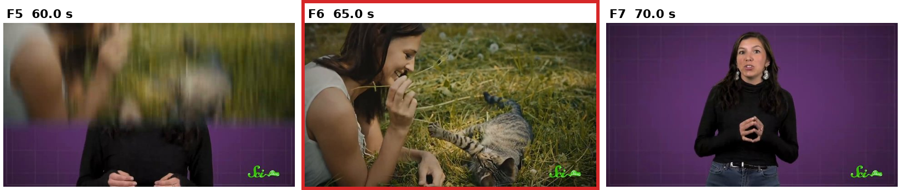
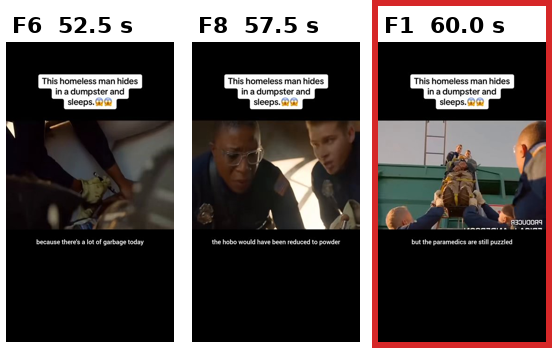

# 2026-10-23 MTG資料: イベント書き起こしAgent

## 0. 今日のMTGで相談したいこと

1. **区間をまたいで、同じ人の呼び方をそろえる方法。** 今は各区間を独立に書くので、同じ人でも区間ごとに呼び方が変わります（第5.3節）。前の区間の人物一覧（IDと呼び方）を記録Agentに渡す方式に進めてよいか、相談したいです。
2. **サンプリングの間隔。** 長い動画は10秒に1枚にしたため、短い動作が記録から落ちます（第5.4節の買い物かご）。精度と速さのどちらを優先するか、相談したいです。
3. **予習（事前情報）の入れ方。** 「どんな質問が来るか」を文章で足した版（v6g-lvb）は、効果が見えませんでした（第3.5節・第6節）。書く内容そのものを変える方向でよいか、相談したいです。

## 1. 現時点の結論

- イベント書き起こしAgent（記録Agent）は、**v6g を既定**にしました。20秒（または区間の長さを変えて）8枚の画像を見せ、「変化」を1行1イベントで書かせます。
- プロンプトの目的は、次のように変わってきました。
  1. 自由な文章 → **後で質問に答えるための索引**（6種類で細かく書く）
  2. → **画像と時刻を正しく対応させる**、暴走を止める
  3. → 指示どおり **イベント（＝変化）だけ** を書く
  4. → **区間をまたいで同じ人を見つけられる** 呼び方にする
- 10/22の実験（LongVideoBench、8秒〜約1時間の動画、120本）で、**記録 → 集約 → 回答が最後まで動き、記録があると正答率が上がる**ことを確かめました（記録なし 25〜43% → 記録あり 53〜70%）。
- うまくいかない原因は、**(1) 枚と枚の間で起きたことは書けない、(2) 記録と質問で言い方が違う、(3) まれに同じ行を繰り返す、(4) 区間ごとに同じ人の呼び方が変わる** の4つでした。

## 2. 背景: 記録Agentの役割

10/19のMTGで決めた構成（予習 → イベント記録 → 集約 → 分割統治で回答）のうち、**動画を見てイベントを文字に起こす段** です。

```txt
動画 ──(20秒ごとに8枚)──▶ 記録Agent（Qwen3-VL-4B）──▶ 時刻付きのイベントの行
                                                          │
                                       集約（段A: 重複をまとめる、段B: 人物ID）
                                                          │
                                       回答Agent（テキストだけを読んで答える）
```

- モデルは `Qwen/Qwen3-VL-4B-Instruct`、temperature 0（毎回同じ出力）、上限 4096 token。
- **質問は記録Agentに渡しません。** 「質問は後から来る」前提のためです。
- 前の区間の記録も渡しません。各区間は独立に書かれます。
- **この記録が動画の唯一の記録** です。回答Agentは動画を見ず、この記録だけを読んで答えます。

## 3. プロンプトの変遷: 目的がどう変わったか

全体の流れ（詳しくは [プロンプトの変遷](../experiments/2026-10-21-record-prompt-evolution.md)）:

| 段階 | 版 | 目的 | 結果 |
|---|---|---|---|
| 出発点 | 旧Workbench | 区間の状況を説明する | 短すぎて制御できない |
| ① | v0〜v3 | 後で質問に答える **索引** を作る | 文字のループ、時刻のずれ |
| ② | v4 | **画像と時刻を合わせる**、ループを止める | 時刻のずれ 372行 → 0行 |
| ③ | v5 | 6種類のまま、まとめ損ねを減らす | 遅い、イベントの記録から外れる |
| ④ | v6a〜v6f | **イベント（＝変化）だけ** を書く | 実行時間 1/3〜1/5 |
| ⑤ | v6g | **同じ人を見つけられる呼び方** | 暴走なし、既定にした |
| ⑥ | v6g-lvb（10/22） | 予習（質問の傾向）を足す | 差が見えない |

### 3.0 出発点: 旧Workbenchのプロンプト

区間の状況を、自由な文章で書かせていました。

```txt
Describe the visible people, objects, actions, and meaningful state changes across the clip in chronological order.
Do not add facts that are not directly supported by the visible clip.
Do not infer unseen frames or future events, and do not answer any question.
Return only a concise plain text description.
```

**問題:** 過去のMTGで「プロンプトが短く、モデルを制御できていない」と指摘されました。何のために書くか、何を1つのイベントとするか、人をどう呼ぶか、出力の形が決まっていません。

### 3.1 目的①: 後で質問に答えるための「索引」を作る（v0〜v3）

**目的:** 記録が「後で、動画を見られない人が質問に答えるために読む唯一の記録」だと伝える。LongVideoBenchの質問は見た目の細かい説明で場面を指すので、細かく、1行1事実で書かせる。

v0で、冒頭に目的を書き、6種類に分けて書かせました。

```txt
You are writing a visual log of a long video. This log is the only record of the video that will be kept. Later, someone who cannot watch the video will use only this log to answer multiple-choice questions about it.
...
What to record:
- SCENE: the place and background ...
- ENTITY: each visible person, animal, and important object, with its appearance.
- EVENT: each action or happening, in time order.
- CHANGE: a change in how a person or object looks or where it is ...
- TEXT: text that is part of the image (titles, signs, labels). Copy it exactly.

Output format:
Each line is: - [start-end] TYPE: description
start and end are timestamps in seconds copied from the frame list.
```

**問題（v3を実際の動画で動かして分かったこと）:**

- 看板の文字を延々と繰り返し、上限の4096 tokenまで書き続けた（1区間146行中136行が同じ行）。

  ```txt
  - [100.0-120.0] TEXT: "BROADWAY HOLLYWOOD" on the billboard
  - [100.0-120.0] TEXT: "BROADWAY HOLLYWOOD" on the billboard
  - [100.0-120.0] TEXT: "BROADWAY HOLLYWOOD" on the billboard
  ```
- 8枚とも違う場面なのに、1枚目の場面だけを書いた。
- 3分の動画に14分16秒かかった。書いた時刻と画像の中身が合わない行が416行中372行。

### 3.2 目的②: 画像と時刻を正しく対応させる（v4）

**目的:** ループを止め、書いた時刻と画像の中身を合わせる。

- 秒で書かせると、画像と時刻が1枚ずれました。4Bのモデルは「何枚目が何秒か」を文章からは正しく読み取れません。
- 2つ直しました。
  1. **入力の形（コード）:** 各画像の直前に `frame 3 (125.0 s):` というラベルを置く。
  2. **書き方（プロンプト）:** 秒ではなく **frame番号** で範囲を書かせる。秒への変換はコードが行う。

```diff
-Each line is: - [start-end] TYPE: description
+Each line is: - [Ffirst-Flast] TYPE: description
```

**結果（同じ3分の動画、v3 → v4）:**

| 項目 | v3 | v4 |
|---|--:|--:|
| 全体の時間 | 14分16秒 | 6分16秒 |
| 上限に達した区間 | 2 | 0 |
| 文字（TEXT）の行 | 277 | 19 |
| 時刻が画像と合わない行 | 372 | 0 |

この「ラベル＋frame番号」の形は、今の版まで引き継いでいます。

### 3.3 目的③: 指示どおり「イベント」だけを書く（v5 → v6a〜v6f）

v5では、6種類のまま、まとめ損ねなどを減らしました。しかし、次の問題に気づきました。

- **指示から外れていた。** 10/19に決めたのは「イベントをタイムスタンプ付きで記録する」ことでしたが、v3〜v5は場面の目録（場所・人・物・文字の一覧）になっていました。
- 6種類は、LongVideoBenchのタスク名から作ったもので、他の分け方と比べて選んだものではありません。実際の出力でも、種類の境界は守られていませんでした。
- 遅く、暴走しやすい（3分の動画で250〜480秒。スマホの設定画面で色の名前を297行）。

**目的:** EVENTだけを書く版を一から作る。どのベンチマークでも使えるように、特定の質問の形を前提にしない。

v6aでは、イベントを **変化** と定義しました（GEBD, ICCV 2021 にならう）。

```txt
What an event is:
An event is a change. Go through the frames in order and write one event each time one of these happens:
1. A person, animal, or object starts an action, stops it, or switches to another action ...
2. Someone starts or stops handling an object (picks it up, puts it down, hands it over, turns it on).
3. A person, animal, or object comes into view or leaves the view.
4. The place or the view changes ...
```

**結果:** 実行時間は v5 の約1/3〜1/5（Vlog 480秒 → 91秒）。行数も 304行 → 31行。

その後 v6b〜v6f で、出てきた問題を1つずつ直しました。

| 版 | 出てきた問題 | 足した規則 |
|---|---|---|
| v6b | 続いている動作を `continues to …` で別の行に分ける | 続く動作は1行にまとめる（誤りと正しい例の組） |
| v6c | 画面の文字やアイコンを並べる | 付けてよい情報は1つだけ |
| v6d | 区切りがあいまい | 先に区切りを見つけてから書く手順 |
| v6e | カメラが寄っただけで同じ文を3行 | 寄り・引き・角度の変化は区切らない |
| v6f | 状態だけの行 | 自己チェックの手順（**効かなかった**） |

v6fで、同じ出力が続き、プロンプトだけの改善は頭打ちと判断しました。

### 3.4 目的④: 区間をまたいで同じ人を見つけられるようにする（v6g）

**きっかけ:** 集約の段B（区間をまたいで同じ人にIDを振る処理）で、`man in a dark suit` や `man in a black T-shirt` のような薄い呼び方では、別人を同じIDにしてしまいました。プロンプトの例の呼び方がどれも服1つだけで、モデルがそれを真似していた可能性が高いです。

**目的:** 人を、動画を通して変わらない3つの特徴で呼ばせる。

```diff
-- One event per line. Write who does what: name people and animals by how they look, such as "man in a black T-shirt", and use the same name every time.
+- One event per line. Write who does what.
+- Name each person by three features that stay the same during the whole video, so that the same person can be found again in other parts of the video:
+  1. the upper clothing, with its color and type ...
+  2. the hair or face ...
+  3. one more thing that is easy to recognize ...
+- Write "man" or "woman" only when it is clear. If you are not sure, write "person".
```

**結果:** 暴走なし。呼び方はほぼ3つの特徴になりました（例: `man in a black T-shirt with "SEEK DISCOMFORT" text and short blond hair`）。v5で暴走した2本でも、暴走しませんでした。

**うまくいかなかった試み（v6h）:** 似た3人（全員 黒いTシャツ・ひげ）を書き分けさせるため、髪型とひげの形も書かせましたが、指示はほとんど守られず、ほぼ全員 `short dark hair` になりました。**4Bのモデルは別の区間に似た人がいることを知らないので、プロンプトで書き分けさせるのは難しい**、と判断しました。v6gを既定にしています。

### 3.5 10/22: 予習（事前情報）を足す試み（v6g-lvb）

v6gに、「どんな質問が来るか」を説明する1節を足しました。人が設計した事前情報で、質問そのものは渡しません。

```txt
What the questions will ask (known in advance):
The questions are multiple-choice. Each question first points to one or more moments of the video by describing how they look ..., and then asks one of these:
- what a person or animal does at that moment;
- which objects are there at that moment, ...
- what happens just before or just after an event, ...
So write the log so that each moment can be found again from how it looks ...
```

結果: 記録だけの正答率は、4グループとも v6g と ±2ポイント以内で、差は見えませんでした。記録の時間は6〜16%増えました。今回の事前情報は「どんな質問が来るか」を伝えただけで、書く内容（1行1イベント、細部は1つ）は変えていないためだと考えます（推測）。

## 4. 完成版（v6g）のプロンプトの詳しい説明

### 4.1 モデルに渡る形

1回の呼び出しで、1区間分の画像8枚とプロンプトを渡します。

```txt
frame 1 (60.0 s):  [画像1]
frame 2 (62.5 s):  [画像2]
…
frame 8 (77.5 s):  [画像8]
（プロンプト本文。{{chunk.frame_manifest}} に frame 1: 60.0 s … の一覧が入る）
```

- 渡さないもの: 質問と選択肢、前の区間の記録、字幕。

### 4.2 プロンプト本文（v6g、全文）

```txt
You are transcribing the events of a video into a time-stamped log. This log is the only record of the video that will be kept. Later, someone who cannot watch the video will read it to answer questions about what happened.

You are given one window of the video. Each image above is shown right after its label, such as "frame 1 (120.0 s):". The frames of this window are:
{{chunk.frame_manifest}}

Refer to frames by their numbers: F1 is frame 1, F2 is frame 2, and so on.

What an event is:
An event is a change. Go through the frames in order and write one event each time one of these happens:
1. A person, animal, or object starts an action, stops it, or switches to another action (for example, a man stops talking and holds up a phone). Each repetition of the same action is a new event.
2. Someone starts or stops handling an object (picks it up, puts it down, hands it over, turns it on).
3. A person, animal, or object comes into view or leaves the view.
4. The place or the view changes: a cut to a different place, the camera turning to a new view, or a large change of light or color.
At F1 you cannot see what came before, so start by writing what each visible person or animal is doing at F1.

How to find the events:
1. Compare each frame with the frame before it, and note the frames where something changes. These are the boundaries.
2. Between two boundaries nothing changes, so write one line that covers all those frames, from the first to the last.
3. If the next frame shows the same person doing the same thing in the same place, there is no boundary there: the line just gets longer. This is true even when the camera only moves closer, farther, or to another angle. A change of the person's facial expression or new subtitle text is not a boundary either.
4. Every line must say what changed at its first frame, so that it is different from the line before it. When the place changes, start the line with "view cuts to" and name the new place.

How to write an event:
- One event per line. Write who does what.
- Name each person by three features that stay the same during the whole video, so that the same person can be found again in other parts of the video:
  1. the upper clothing, with its color and type (for example, "black T-shirt", "red plaid shirt", "dark gray suit");
  2. the hair or face (for example, "short brown hair", "long blond hair", "bald", "glasses", "beard");
  3. one more thing that is easy to recognize (for example, text written on the clothing, a hat, a necklace, black gloves, a backpack).
  Example: "man in a black T-shirt with "SEEK" text, short brown hair". Write a feature only when you can see it; if you cannot see a feature, write the features you can see. Use the same three features every time the person appears.
- Write "man" or "woman" only when it is clear. If you are not sure, write "person". Never call the same person "man" in one line and "woman" in another.
- Name animals in the same way (color, size, one distinctive feature). Things that are not people or animals do not need these features.
- You may add one short detail about something that takes part in the event, such as what is shown on a phone screen or what the new place looks like. Add only one short detail: copy at most a few words of a long text, and do not list several objects, texts, signs, or icons. Do not describe things that do not take part in the event.
- For a change of place, name the new place with at most two features, such as "white room with a blue sofa".
- Write events of people in the background too, but only when you can clearly see what they do. Write the main people first.
- Write only what you can see. Do not guess hidden actions, reasons, or feelings.
- An action that continues over several frames is one event: write it once, with the range from its first frame to its last frame. Never write "continues", "still", or "again" for an action that has not stopped.
- Never write the same event twice. When every change in the frames is written, stop.

Do not write lines like these:
- Wrong (one action split into several lines):
  - [F6-F6] EVENT: man in a navy suit with gray hair and glasses speaks outside a building
  - [F7-F8] EVENT: man in a navy suit with gray hair and glasses continues to speak outside a building
  Right: - [F6-F8] EVENT: man in a navy suit with gray hair and glasses speaks outside a building
- Wrong (the same line repeated; the camera only moved closer):
  - [F1-F2] EVENT: woman in a beige coat with long black hair and a pearl necklace speaks outside a building
  - [F3-F4] EVENT: woman in a beige coat with long black hair and a pearl necklace speaks outside a building
  Right: - [F1-F4] EVENT: woman in a beige coat with long black hair and a pearl necklace speaks outside a building
- Wrong (a person named by one feature only, which many people share): - [F2-F2] EVENT: man in a white shirt runs across a street
  Right: - [F2-F2] EVENT: man in a white shirt with short black hair and a blue backpack runs across a street
- Wrong (a list of details): - [F5-F5] EVENT: view cuts to a blue screen with "Subscribe" text, two video thumbnails, and icons for Instagram, Twitter, and Snapchat
  Right: - [F5-F5] EVENT: view cuts to a blue screen with the text "Subscribe"

Output format:
Each line is: - [Ffirst-Flast] EVENT: description
[F3-F5] means the event is seen from frame 3 to frame 5. Use [F4-F4] for a single frame.

Example (from a different video with 8 frames):
- [F1-F3] EVENT: woman in a red apron with long black hair tied back and silver earrings talks to the camera in a kitchen with white tiles
- [F4-F4] EVENT: woman in a red apron with long black hair tied back and silver earrings picks up a brown egg
- [F5-F5] EVENT: woman in a red apron with long black hair tied back and silver earrings cracks the egg into a glass bowl
- [F6-F6] EVENT: view cuts to a close-up of a frying pan on a gas stove
- [F7-F8] EVENT: beaten egg is poured into the frying pan
- [F8-F8] EVENT: boy in a yellow T-shirt with short curly hair and a green cap comes into view from the right

Now write the events of this window.
```

### 4.3 各部分の役割と、その規則が入った理由

プロンプトは8つの部分でできています。どの規則も、前の版で実際に起きた問題を直すために入れたものです。

| # | 部分 | 書いていること | 入った理由（直した問題） |
|---|---|---|---|
| 1 | 役割 | 動画の唯一の記録で、後で見られない人が質問に答えるために読む | 旧Workbenchは何のために書くかが分からず、何が大事か判断できなかった |
| 2 | 入力の説明 | 各画像はラベルの直後にある。frame は `F1`, `F2` で指す | 秒で書かせると画像と時刻が1枚ずれた（v4） |
| 3 | イベントの定義 | イベント＝変化。動作の始まり・終わり、物の扱い、出入り、場所の変化の4つ | v3〜v5は場面の目録になり、指示から外れていた（v6） |
| 4 | イベントの見つけ方 | 先に区切りを見つけ、区切りの間を1行にする。カメラの寄り・角度、表情、字幕では区切らない | 同じ動作やカメラの寄りで、同じ文が何行も並んだ（v6d・v6e） |
| 5 | 書き方の規則 | 人を3つの特徴で呼ぶ／性別は明らかなときだけ／付け足す情報は1つ／見えるものだけ／`continues` を使わない／書き終えたら止める | 段Bで別人を同じIDにした（v6g）。文字やアイコンを並べて暴走した（v3・v5）。続く動作を別の行に分けた（v6a） |
| 6 | 書いてはいけない例 | 誤りと正しい書き方の組を4つ | 規則だけより、例の組の方が効いた（v5bで確認） |
| 7 | 出力の形 | `- [F最初-F最後] EVENT: 説明` | frame番号で範囲を書かせると、全frameで対応が正しくなった（v4d） |
| 8 | 出力例と開始の合図 | 別の動画の8枚分の例を6行 | 例の呼び方をモデルが真似するので、例も3つの特徴の形にした（v6g） |

補足:

- `EVENT:` という語は、6種類で書かせていた頃の名残です。今は意味がありませんが、行を読む正規表現が `種類:` を前提にしているので残しています。
- 例の中のコンマ（`"SEEK" text, short brown hair`）をモデルが真似し、段Bの主語の取り出しがコンマで止まる問題がありました。段Bの側で直しています。

### 4.4 出力がどう変換されるか

モデルは frame番号で書き、コード（`record_log.py`）が秒に直します。

```txt
モデルの出力:  - [F1-F3] EVENT: woman in a black coat with long black hair and a yellow face mask walks beside ...
保存される行:  [0.0-5.0] EVENT: woman in a black coat ...   （frame 1 の時刻 〜 frame 3 の時刻）
```

- 終わりの時刻は「最後に見えた frame の時刻」です。区間の終わりではありません。
- 結果は `result.json`（正本）と `record.md`（人が読む用）に保存されます。モデルに見せた画像も `frames/` に残しています。

## 5. 実際の出力: うまくいった例・うまくいかなかった例

### 5.1 使った実験（10/22〜23）

| 項目 | 内容 |
|---|---|
| データ | LongVideoBench val。字幕を使わない10カテゴリ |
| 動画 | 4つの長さのグループ（8–15秒、15–60秒、3–10分、15–60分）から各30本、計208問 |
| 記録 | v6g と v6g-lvb。区間あたり8枚。1枚の間隔は 1 / 2.5 / 5 / 10 秒（長い動画ほど広い） |
| 回答 | 同じ4Bモデルに、記録（テキストだけ）と質問を渡して答えさせる |
| 対照 | 記録を渡さない「記録なし」 |

**正答率（v6g、記録だけを渡したとき）:**

| グループ | 1枚の間隔 | 問 | 記録なし | 記録あり | チャンス |
|---|--:|--:|--:|--:|--:|
| 8–15秒 | 1秒 | 28 | 25% | 68% | 21% |
| 15–60秒 | 2.5秒 | 30 | 33% | 70% | 22% |
| 3–10分 | 5秒 | 60 | 43% | 53% | 21% |
| 15–60分 | 10秒 | 90 | 34% | 60% | 20% |

- どのグループでも、記録があると正答率が上がりました。
- 問題数が少なく、28〜30問では ±17ポイント程度の幅があります。

208問を、記録あり・記録なしの正誤で分けると次のようになります（v6g、記録だけ）。

| | 記録なしで正解 | 記録なしで不正解 |
|---|--:|--:|
| 記録ありで正解 | 57 | **69**（記録のおかげで正解） |
| 記録ありで不正解 | **17**（記録で悪くなった） | 65 |

以下の例は、ここから選びました。

### 5.2 うまくいった例①: 短い動画で、場面と動作をそのまま書けた

**この図で見る点:** F5（赤枠）で「WATER LINK」と書かれた乗り物に女性が乗っている場面が、記録の1行になっています。



- 動画: `@placesunleashed-7297000148201262341`（10秒、1秒に1枚）
- 質問（S2E）: 海の上で、「WATER LINK」と書かれた乗り物にサングラスの女性が乗っている。この女性は何をしているか。
- 正解: She is driving an amphibious car（水陸両用車を運転している）

記録（ウィンドウ1の一部）:

```txt
- [3.0-3.0] EVENT: view cuts to yellow car with "WATER LINK" text driving on water, with the Burj Al Arab hotel in the background
- [4.0-4.0] EVENT: view cuts to black car with "WATER LINK" text driving on water, with a woman in sunglasses inside
- [5.0-5.0] EVENT: view cuts to man in a dark suit with a blue tie and short brown hair speaking at a microphone
```

| 入力 | 回答 | 正誤 |
|---|---|---|
| 記録なし | She is lying in the car | 不正解 |
| 記録あり | She is driving an amphibious car | **正解** |

**なぜうまくいったか:** 質問が場面を指す手がかり（「WATER LINK」の文字、サングラスの女性）が、記録の行にそのまま書かれていました。付け足す情報を1つに絞る規則（服の文字や画面の文字を数語だけ写す）が、ちょうど質問の手がかりと一致しました。

### 5.3 うまくいった例②: 長い動画で、同じ人を別の場面でも見つけられた

**この図で見る点:** 290秒（赤枠）で親指を立てる男性と、760秒（赤枠）の浜辺の男性が同じ人です。記録はどちらも `man in a gray T-shirt … and a backpack` と書いています。



- 動画: `JDtVwz1R-kI`（約20分、10秒に1枚）
- 質問（SOS: 同じ人の再登場）: グレーの半袖でリュックを背負い、右手の親指を立てている男性。この男性は他にどこに出てきたか。
- 正解: On the beach（浜辺）

記録（関係する行）:

```txt
- [290.0-290.0] EVENT: man in a gray T-shirt with short dark hair and a backpack gives a thumbs-up gesture
- [760.0-790.0] EVENT: man in a gray T-shirt with short brown hair and a backpack talks to another man in black shorts with short brown hair and sunglasses, who gives a thumbs-up gesture
```

| 入力 | 回答 | 正誤 |
|---|---|---|
| 記録なし | On a motorcycle | 不正解 |
| 記録あり（83行、約4,000 token） | On the beach | **正解** |

**なぜうまくいったか:** v6gで入れた「3つの特徴で呼ぶ」規則により、約8分離れた2つの場面で、同じ人が「グレーのTシャツ＋リュック」で書かれていました。回答Agentは、この呼び方を手がかりに浜辺の行を見つけられました。

**ただし、呼び方は完全にはそろっていません（第6節の問題1につながる）。** 同じ動画で、この男性は区間ごとに次のように書かれました。

| 時刻 | 記録の呼び方 |
|---|---|
| 50秒 | `man in a gray T-shirt with short dark hair and a beard, wearing a blue neck pillow and a backpack` |
| 90秒 | `man in a gray T-shirt with short black hair and a blue neck pillow` |
| 480秒 | `man in a gray T-shirt with short brown hair and a black watch` |
| 880秒 | `man in a gray T-shirt with short dark curly hair and a backpack` |

- 1つ目の特徴（グレーのTシャツ）は保たれていますが、髪の色（dark / black / brown）と3つ目の特徴（ネックピロー、時計、リュック）が変わります。
- また、800秒の画像には上半身裸の男性が写っていますが、記録は `man in a gray T-shirt with short dark hair and a necklace talks to the camera` と書いていました。別の人を同じ呼び方で書いたのか、服を書き間違えたのかは、画像からは判断できません。

### 5.4 うまくいかなかった例①: 枚と枚の間で起きたことは書けない

**この図で見る点:** F3（5.0秒）でブルーベリーを手に取り、F4（7.5秒）ではもうニンジンを取っています。**ブルーベリーをかごに入れる瞬間は、8枚のどれにも写っていません。** F6（12.5秒）で初めて「かごに入れる」場面が写ります。



- 動画: `@lisolna-7359951777845775648`（約60秒、2.5秒に1枚）
- 質問（O3O: 物の前後）: 動画で最初にかごに入れたものは何か。
- 正解: A box of blueberries（ブルーベリー）

記録:

```txt
- [0.0-2.5] EVENT: view cuts to a shopping cart with a yellow sticker that reads "DEINE MEINUNG ZÄHLT" on a tiled floor
- [5.0-5.0] EVENT: woman in a black long-sleeved shirt with dark nail polish picks up a container of blueberries from a cardboard box
- [7.5-7.5] EVENT: woman in a black long-sleeved shirt with dark nail polish picks up a bag of carrots from a cardboard box
- [10.0-10.0] EVENT: woman in a black long-sleeved shirt with dark nail polish picks up a container of cherry tomatoes from a cardboard box
- [12.5-12.5] EVENT: woman in a black long-sleeved shirt with dark nail polish places the container of cherry tomatoes into the shopping cart
```

| 入力 | 回答 | 正誤 |
|---|---|---|
| 記録なし | A box of blueberries | 正解 |
| 記録あり | A box of cherry tomatoes | **不正解** |

**なぜうまくいかなかったか:**

- 記録は、写っている範囲ではほぼ正しいです（手に取る順番：ブルーベリー → ニンジン → ミニトマト）。
- しかし、「かごに入れる」と書かれた最初の行がミニトマトだったので、回答Agentはミニトマトを選びました。
- 原因は、**2.5秒の間隔の間に動作が終わってしまったこと** です。プロンプトでは直せず、サンプリングの間隔の問題です。
- O3O（物の前後）は、10カテゴリの中で唯一、記録ありの方が記録なしより悪いカテゴリでした（4/20 対 7/20）。記録Agentは「動作」を書くので、物がいつ現れたか・かごに入ったかのような、物の状態の変化は落ちやすいと考えます（推測）。

### 5.5 うまくいかなかった例②: 記録は合っているが、言い方が違う

**この図で見る点:** F6（65秒、赤枠）で、女性が細い草の茎を持って子猫と遊んでいます。



- 動画: `VSZ8ywgGNGM`（約4分、5秒に1枚）
- 質問（E2O）: 草原で、袖なしの白いシャツの女性がしゃがみ、前に子猫がいる。女性は子猫と遊ぶために何を手に持っているか。
- 正解: a blade of grass（草の葉）

記録:

```txt
- [65.0-65.0] EVENT: woman in a light gray sleeveless top with dark hair and a tabby cat with striped fur lie in grass, woman smiles while holding a plant stem
```

| 入力 | 回答 | 正誤 |
|---|---|---|
| 記録なし | a cat tease stick | 不正解 |
| 記録あり | a flower | **不正解** |

**なぜうまくいかなかったか:**

- 記録は正しく書けています（`holding a plant stem` ＝ 植物の茎を持っている）。
- しかし、選択肢は `a flower` と `a blade of grass` で、回答Agentは「植物」から `a flower` を選びました。
- **記録と質問で、同じものの言い方が違う** と外れます。10/22のパイロットでも、じゃがいもを「豆腐」と書いた質問で、回答Agentが答えを断る例がありました。これは記録Agentより回答Agent側の問題です。

### 5.6 うまくいかなかった例③: 1枚だけの区間で、同じ行を繰り返した

**この図で見る点:** 動画の最後の区間は、60.0秒の1枚（赤枠）だけでした。



- 動画: `@movie.explained6-7275653401025826050`（60.03秒、2.5秒に1枚）
- 最後の区間（60.0〜60.03秒）は1枚だけで、次の行を **120回以上** 繰り返し、上限の4096 tokenに達しました（この区間だけで280秒）。

```txt
- [60.0-60.0] EVENT: man in a blue uniform with short blond hair and white gloves lifts a person on a stretcher while others assist from below
- [60.0-60.0] EVENT: man in a blue uniform with short blond hair and white gloves lifts a person on a stretcher while others assist from below
- [60.0-60.0] EVENT: man in a blue uniform with short blond hair and white gloves lifts a person on a stretcher while others assist from below
（以下、同じ行が続く）
```

| | 区間1〜3（各8枚） | 区間4（1枚） |
|---|--:|--:|
| 行数 | 7 / 8 / 8 | 121 |
| 生成token | 217 / 250 / 219 | 4,096（上限） |
| 時間 | 16〜18秒 | 280秒 |

- この区間の内容自体は正しい行です。集約の段Aが重複をまとめたので（144行 → 25行）、回答は正解でした（ゴミ収集車の中の消防士 → Inside a garbage truck）。
- 1枚だけでは「前の枚と比べて変化を見つける」手順が使えないことが、繰り返しの一因かもしれません（推測）。ただし、1枚だけの区間はほかにも約40個あり（パイロットを含む）、暴走したのはこの動画（v6g・v6g-lvbの両方）だけでした。
- 2条件・240本の記録のうち、上限に達した区間は3つでした（この動画 × 2条件と、15–60分の動画の8枚の区間1つ）。

## 6. 今回言えること / まだ言えないこと

### 言えること

- v6gは、8秒〜約1時間の動画で、240本中236本の記録を最後まで書けた（失敗4本は、逐次ローダーの端の処理の問題）。
- 記録を渡すと、どの長さのグループでも正答率が上がった（記録なしより +10〜+43ポイント）。
- v3 → v4 で、画像と時刻のずれ（372行 → 0行）と暴走（2区間 → 0区間）を直したのは、プロンプトの文章ではなく **入力の形（ラベル）と書き方（frame番号）** だった。
- 4Bのモデルに、プロンプトだけで「似た人の書き分け」や「区間をまたいだ呼び方の統一」をさせるのは難しかった（v6h、第5.3節）。

### まだ言えないこと

- **事前情報（v6g-lvb）が効くか。** 正答率は v6g と ±2ポイント以内で、差は見えない。
- **集約（段A・段B）が回答に効くか。** 段Aで減る行は3〜7%だけで、差は見えない。
- **サンプリングの間隔だけの影響。** 長い動画ほど正答率が低いが、グループごとに問題の難しさも違う。同じ動画で間隔だけを変えて比べていない。
- 5.6節の繰り返しが、1枚だけの区間で起きやすいのかどうか。

## 7. 次に進む候補（まだ決定ではない）

| 候補 | ねらい | 対応する問題 |
|---|---|---|
| 前の区間の人物一覧（IDと呼び方）を記録Agentに渡す | 区間をまたいで呼び方をそろえる | 5.3節 |
| 同じ動画で、間隔だけを変えて比べる（10秒・5秒・2.5秒） | 間隔と精度の関係を、問題の難しさと分けて見る | 5.4節 |
| 物の登場・退場を書かせる予習を試す | 弱いカテゴリ（O3O, S2O）を補う | 5.4節 |
| 回答Agentに、記録と選択肢の言い換えを考えさせる | 言い方の違いで外すのを減らす | 5.5節 |
| 同じ行がN回続いたら打ち切る、1枚だけの区間を前の区間に含める | 繰り返しを止める | 5.6節 |

前の区間の情報を渡す案は、「前の区間の文章を渡すと悪くなる」という報告（Lando、MemLife）もあり、文章ではなく人物の一覧だけを渡す形を考えています。

## 8. 図・生成物

| ファイル | 内容 |
|---|---|
| `figures/2026-10-23-event-transcription-agent/01-success-water-link.png` | 成功例①の8枚 |
| `figures/2026-10-23-event-transcription-agent/02-success-same-man-across-video.png` | 成功例②の4枚（50・290・760・800秒） |
| `figures/2026-10-23-event-transcription-agent/03-failure-shopping-cart.png` | 失敗例①の8枚 |
| `figures/2026-10-23-event-transcription-agent/04-failure-kitten-grass.png` | 失敗例②の3枚 |
| `figures/2026-10-23-event-transcription-agent/05-failure-runaway-last-frame.png` | 失敗例③の3枚 |

いずれも、記録Agentに実際に渡した画像（`frames/`）を並べ、上に frame番号と時刻を付けたものです。

## 9. 参照ファイル

- [記録Agentのプロンプトの変遷](../experiments/2026-10-21-record-prompt-evolution.md)（旧Workbench → v6h、各版の本文・差分・出力例）
- [動画長グループ別の試行](../experiments/2026-10-22-lvb-duration-groups.md)（10/22の実験の条件・結果・考察）
- [動画長グループ別の試行のプロンプト](../experiments/2026-10-22-lvb-duration-groups-prompts.md)（v6g-lvb、回答 a1〜a3）
- [記録・集約の入出力の説明](2026-10-22-event-record-aggregation-io-explainer.md)
- プロンプト本文: Workbenchリポジトリ `2026_10_hayashi_pre_study_agent_system_workbench` の `prompts/history/record/`
- 実験の生出力: 同リポジトリ `outputs/2026-10-22_23-39-02/`（本番）、`outputs/2026-10-22_22-50-35/`（パイロット。各グループ先頭5本の記録は本番でもこれを使用）
