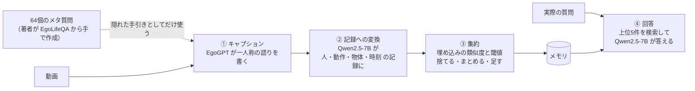

# MTG資料: 「予習」＋「イベント書き起こし」に近い論文（Imprint）

## 0. 今日のMTGで相談したいこと

1. 「予習した観点でイベントを書き起こす」という核の部分は、Imprint（2026-07）がすでにやっていました。私たちの違いを **どこに置くか**（下の 6 の候補のどれを主張にするか）を相談したいです。
2. 今の第1版（予習を人が書いたプロンプトで代用）は、Imprint とほぼ同じことをしています。このまま第1版を基準として進め、違いの部分を足していく順番でよいかを確認したいです。

## 1. 結論（一言で）

- **Imprint は「データセットの質問から作った型」を、キャプションの書き方にだけ使っている。**
- 私たちは、予習した観点を **記録だけでなく集約にも使い**、**時間スケールごとにまとめる** 点で違いを出せる見込み。ただし、どちらもまだ実験していない。

## 2. Imprint とはどんな論文か

- Kousik Das, Debaditya Roy（IIT Kharagpur）. *Imprint: Online Memory Compression for Long-Horizon Egocentric QA*. arXiv 2607.00696（2026-07）
  - https://arxiv.org/abs/2607.00696
- 対象：一人称視点の **7日間のライフログ動画** への質問応答（EgoLifeQA）。ストリーミングVideoQAのベンチマークではない。
- 質問が来るタイミング：記録を作り終えた後（私たちの「質問は後から来る」設定と同じ）。
- 比較相手：EgoRAG（EgoLife の論文で提案）。キャプションを分・時間・日の階層の要約にして保存し、検索して答える方法。
  - Imprint は「要約すると、繰り返しのやり取りが粗い記述に吸収され、長期の集計に弱い」と批判している。

## 3. 処理の流れ

この図で見る点：**予習（メタ質問）が効いているのは①のキャプションだけ** で、③の集約は予習と関係のない決まった規則で動いている。

### ① キャプション（ここが「予習」に当たる）

- EgoGPT が、動画を一人称の語り（"I" が主語の自由な文章）で書く。
- 著者が EgoLifeQA をもとに作った **64個のメタ質問**（5カテゴリ：Episodic, Social, Behavioral, Temporal, Goal-Oriented）を、**全部そのままプロンプトに入れる**。
  - 例："Who used the [object]?" / "Where was the [object]?" / "What was in the [container]?"
- 指示は「これには答えず、一覧も書かないこと。語りを詳しくするための隠れた手引きとしてだけ使うこと」。
- EgoGPT を使う理由（本文）：EgoRAG と同じキャプションにして、性能の差が記録と検索の作りから来るようにするため。

### ② 記録への変換

- Qwen2.5-7B-Instruct が、語りを **1つのやり取りにつき1件の記録**（人・動作・物体・開始時刻・終了時刻、＋道具・場所・発話など）に変換する。

### ③ 集約（LLMは使わない）

- 「動作＋物体」の埋め込みを、直前5件と合わせて文脈つきにする。
- 似た「イベントの型」に割り当てる（類似度 > 0.75、上限300個）。型は回数と最後に見た時刻を数えるためのもの。
- 重要度（頻度 × 新しさ × 珍しさ）が 0.2 未満の記録は捨てる。
- 動作と物体が一致して文脈も近ければ（cos > 0.75）既存の記録にまとめ、そうでなければ新しく足す。
- 操作は「捨てる・まとめる・足す」だけ。**階層や時間スケールはない**。

### ④ 回答

- LLM が質問を「人・動作・物体・時間の関係（最初・最後・前・後）」に分解する。
- 質問時刻より前の記録から、近さと重要度で上位5件を取り出し、Qwen2.5-7B-Instruct が答える。回数を数える質問などは規則で先に処理する。

## 4. Evidence: 論文の結果（EgoRAG と比べて）

| 指標 | EgoRAG | Imprint |
| --- | --- | --- |
| メモリ | 254.2MB | 109MB |
| 検索時間 | 20.1秒/問 | 1.7秒/問 |
| QA正答率 | 31.0% | 35.8% |
| Grounded Accuracy | 10.8% | 64.8% |

- メタ質問（予習）の効果（付録A.3）：入れると Grounded Accuracy が 5.41% → 64.80%。
  - **QA正答率がどれだけ上がったかの数値は本文にない**（図のみ）。

## 5. 何が「予習」と似ているか

| 観点 | Imprint | 私たち |
| --- | --- | --- |
| 実際の質問を知るタイミング | 記録を作り終えた後 | 動画の後（同じ） |
| 事前に使う知識 | データセットの質問から作った「どんな質問が来そうか」 | データセットの質問の傾向（同じ発想） |
| 知識の使い道 | 何を書き残すかに効かせる | 予習した観点で、何をイベントとして記録するかを決める（同じ） |
| 記録の形 | 時刻付きの記録（人・動作・物体・時刻） | 時刻付きのイベント記録（Markdown） |
| 回答の仕方 | 記録から検索して、7B のLLMが答える | 記録から、小さいモデルが答える |

→ **「データセットの質問の傾向を、質問を知らないまま記録の書き方に使う」という核の部分は、Imprint がすでにやっている。**

## 6. 何が違うか（＝違いを出せる候補）

| 観点 | Imprint | 私たち（想定） |
| --- | --- | --- |
| 予習の作り方 | 著者が手で作った64個の型を固定で使う | データセットの質問の傾向から予習Agentが作る（方法は未定） |
| 予習が効く範囲 | キャプションの書き方だけ | 記録に加えて **集約の仕方も予習で変える**（例：回数を聞かれそうなら数えておく） |
| 集約 | 埋め込みの閾値で「捨てる・まとめる・足す」。1段に並ぶだけ | 似たイベントをまとめる（NMSのような処理）＋ **時間スケールごとのまとめ** |
| 回答 | 上位5件を検索して1つのLLMが答える | 小さいモデル群が分担して答える（分割統治） |
| 対象・評価 | 一人称の7日間のライフログ（EgoLifeQA） | LongVideoBench をオンライン処理として評価 |
| 動画の読み方 | 動画をキャプションに変換してから、記録をオンラインで処理 | 動画を先頭から順に1回だけ読みながら記録する |

主張の候補（Interpretation、まだ相談用の見立て）：

- **A. 予習を集約にも使う**：Imprint との差がいちばんはっきりしている。
- **B. 予習Agentで観点を作る**：手作りの型を固定で使う Imprint との違い。ただし作り方は未定。
- **C. 時間スケールごとのまとめ**：Imprint にはないが、EgoRAG は階層の要約を持っているので、それだけでは新しいと言いにくい。

## 7. 今回言えること / まだ言えないこと

### 言えること

- 「予習＋イベント書き起こし」の組み合わせそのものは、初めてとは言えない（Imprint が先にある）。
- Imprint の予習は、キャプションの書き方にだけ効いている。集約は予習と関係のない決まった規則（論文で確認）。
- Imprint の集約には時間スケールの階層がない（論文で確認）。

### まだ言えないこと

- 予習を集約にも使うこと、時間スケールごとにまとめることが、正答率に効くかどうか（まだ実験していない）。
- 今の私たちの試行（記録 v6g に LongVideoBench の質問の傾向を足した v6g-lvb）でも、事前情報の有無による差は、問題数のばらつきの中に入っていて見えていない（2026-10-22〜23の試行）。
- Imprint のメタ質問を EgoLifeQA のどの分割から作ったか（評価の問題に近いものを使っていないか）は、論文に書かれていない。
- Imprint が集約を閾値で行う理由は論文に明記されていない（オンライン処理・重複の削減・メモリを抑えること、が文脈から読み取れる程度）。

## 8. 注意点：第1版は Imprint とほぼ同じ

- 私たちの第1版は、予習を「人が手で書いたプロンプト」で代用している（2026-10-20 に決定）。**この段階では Imprint とほぼ同じことをしている。**
- 違いを出すには、6 の A（予習を集約にも使う）か B（予習Agentで観点を作る）の部分が必要。

## 9. MTGでの言い方の案

> Imprint は、データセットの質問から作った型を、キャプションの書き方にだけ使っている。私たちは、予習した観点を記録だけでなく集約にも使い、時間スケールごとにまとめる点が違う。

## 10. 参照ファイル

- Notion「2026-2028 林流生 MTG議事録」の 2026-10-22 のやったこと「「予習」＋「イベント書き起こし」に近い論文」
- [先行研究の調査メモ（予習とイベントの書き起こし）](../../../../secretary/notes/brainstorm/2026-10-21-pre-study-and-event-log-prior-work.md)
- [動画長グループ別の試行](../experiments/2026-10-22-lvb-duration-groups.md)
- [2026-10-19 MTG議事録](../meetings/2026-10-19-mtg.md)
