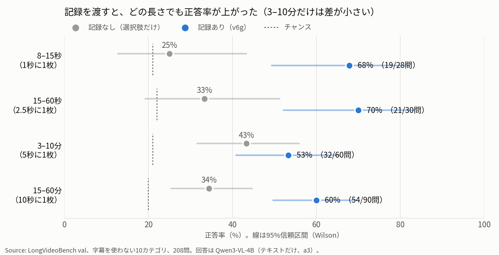
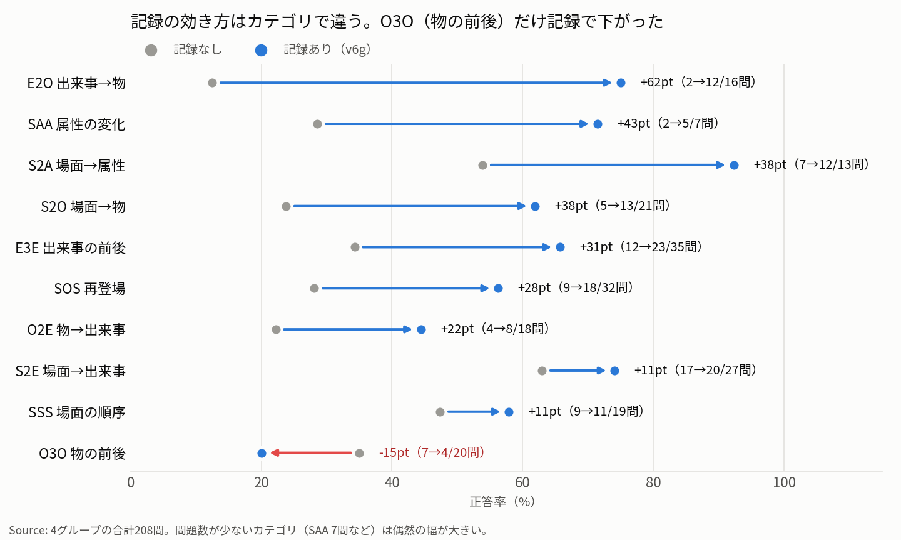

# 2026-10-23 MTG資料: 動画長グループ別の実験結果（記録 → 集約 → 回答）

記録Agent（v6g）の説明は [イベント書き起こしAgentの資料](2026-10-23-event-transcription-agent-mtg-materials.md) にあります。この資料は、その記録を使って **実際に質問に答えさせた実験** の条件と結果です。

## 0. 今日のMTGで先生に相談したいこと

1. **次に比べるもの。** 記録の効果ははっきり出ましたが、集約・事前情報・サンプリング間隔の効果は、今の問題数（208問）では見分けられません。次にどれを優先して確かめるか、相談したいです。
2. **3–10分のグループの扱い。** このグループだけ、記録の効果が小さく、統計的にも差が出ませんでした（第5.2節）。原因の切り分けを続けるか、相談したいです。
3. **集約の役割の見直し。** 今の段Aは行を3〜7%しか減らせず、回答も変わりません（第5.4節）。集約に何をさせるか、相談したいです。

## 1. 結論

| 問い | 答え | 根拠（数値） |
|---|---|---|
| どの長さの動画でも最後まで動くか | **動いた** | 記録 240本中236本成功、回答の形式の失敗 1,248回中4回 |
| 記録は回答に役立つか | **役立つ** | 正答率 36% → 61%（208問）。記録のおかげで正解 69問、記録で外した 17問（p < 0.001） |
| 長い動画をオンラインで記録できるか | **できる** | 3–10分・15–60分では、記録の時間が動画の長さの 0.21〜0.48倍 |
| 集約（段A・段B）は回答に役立つか | **差が見えない** | 正答率 61% / 62% / 59%（記録だけ / 段A / 段A+段B）。どの比較も p > 0.3 |
| 事前情報（v6g-lvb）は役立つか | **差が見えない** | 61% → 62%。片方だけ正解が 11問 / 13問（p = 0.84） |

## 2. 実験の目的

- 10/19のMTGで決めた構成（予習 → イベント記録 → 集約 → 回答）を、**初めて回答まで通して** 動かす。
- **主目的は、8秒〜1時間のどの長さの動画でも、最後まで正常に動くことを確かめること。** 精度は「出れば嬉しい」という位置づけで始めました。
- あわせて、次の3つを比べる。
  1. 記録を渡すと、渡さないより当たるか（記録の効果）
  2. 記録だけ / 段A / 段A+段B のどれを渡すと当たるか（集約の効果）
  3. v6g と v6g-lvb のどちらの記録が当たるか（事前情報の効果）

## 3. 実験の条件

### 3.1 データ

| 項目 | 内容 |
|---|---|
| データセット | LongVideoBench の val |
| カテゴリ | 字幕を使わない10カテゴリ（S2E, S2O, S2A, E2O, O2E, E3E, O3O, SSS, SOS, SAA）。記録Agentは字幕を見ないため |
| 動画の選び方 | 公式の4つの動画長グループから、対象の質問がある動画を各30本、乱数（seed 20261022）で選んだ |
| 質問 | 選んだ動画の、対象カテゴリの質問すべて |
| 選択肢 | 5択が161問、4択が47問。チャンスは約20〜22% |

| グループ | 動画長（val全体の中央値） | 本数 | 質問 | 動画の合計 |
|---|---|--:|--:|--:|
| 8–15秒 | 11.5秒 | 30 | 30（うち2問は記録の失敗で除外 → 28） | 約6分 |
| 15–60秒 | 36秒 | 30 | 30 | 約18分 |
| 3–10分 | 403秒 | 30 | 60 | 約3.0時間 |
| 15–60分 | 1,196秒 | 30 | 90 | 約10.6時間 |

カテゴリの読み方（S=場面、E=出来事、O=物、A=属性。例: S2E =「場面を説明して、その場面の出来事を聞く」）:

| カテゴリ | 聞いていること |
|---|---|
| S2E / S2O / S2A | ある場面で、何をしているか / 何があるか / どんな見た目か |
| E2O / O2E | ある出来事に関わる物 / ある物に関わる出来事 |
| E3E / O3O | ある出来事・物の、直前・直後の出来事・物 |
| SSS | 複数の場面の順序 |
| SOS | 同じ物・人が、他にどの場面に出たか |
| SAA | 同じ物・人の見た目が、どう変わったか |

### 3.2 処理の流れと条件

```txt
動画 ─▶ 記録Agent ─▶ 記録 ─▶ 段A ─▶ 段B
                       │        │       │
                       ▼        ▼       ▼
                    回答Agent（3通りの入力で、それぞれ答える）
         （対照）記録なし ─▶ 回答Agent
```

| 段 | 条件 |
|---|---|
| 記録 | ① **v6g**（今の既定）、② **v6g-lvb**（v6g ＋ 「どんな質問が来るか」の1節）。モデル Qwen3-VL-4B-Instruct、temperature 0、上限 4096 token |
| 集約 | 段A v2（隣り合う同じ動作の行をまとめる）→ 段B v9（同じ人に `P04` のようなIDを付ける）。どちらもコードの規則だけで動く |
| 回答 | 記録と同じ4Bモデル、**テキストだけ**（動画は見ない）。入力は「記録だけ」「段A」「段A+段B」の3通り |
| 対照 | **記録なし**（記録の欄を空にして、質問と選択肢だけで答えさせる）。選択肢だけで当たる割合を見るため |

### 3.3 サンプリングの間隔（グループごとに変えた）

区間あたりの枚数は **8枚に固定** し、**区間の長さ（＝1枚の間隔）だけ** をグループごとに変えました。

| グループ | 区間の長さ | 1枚の間隔 | 理由 |
|---|--:|--:|---|
| 8–15秒 | 8秒 | 1秒 | 2.5秒間隔だと4〜6枚しか見られないので、細かく見る |
| 15–60秒 | 20秒 | 2.5秒 | これまでの既定 |
| 3–10分 | 40秒 | 5秒 | 一晩で終わる量にする |
| 15–60分 | 80秒 | 10秒 | 2.5秒間隔だと、1条件だけでGPU 1枚あたり約11時間かかる |

- 8枚に固定したのは、プロンプト（`F1`〜`F8`）、1回の入力（約8,500 token）、暴走しにくさを、どのグループでもそろえるためです。
- **そのかわり、グループの違いと間隔の違いが重なっています。** 「長い動画ほど精度が下がるか」と「間隔が広いほど精度が下がるか」は、この実験では分けられません。

### 3.4 回答Agentのプロンプト（a3）

```txt
You will answer a multiple-choice question about a video. You cannot watch the video. Instead, you are given a log of the events in the video, written by someone who watched it. The video is {{duration}} long.

Each line of the log is: - [start-end] event. The times are minutes:seconds from the start of the video, and the lines are in time order.

<log>
{{log}}
</log>

Question: {{question}}

Options:
{{options}}

How to answer:
1. The question first describes one or more moments of the video by how they look. Find the lines of the log that best match that description (the place, the people and their clothes, the objects).
2. Read those lines and the lines just before and after them, and choose the option that the log supports best.
3. The log may miss the moment or describe it in other words. Then guess: choose the option that fits the log best. You must always choose one option. Do not explain and do not say that the log does not mention it.

Answer with the option's letter from the given choices directly.
The best answer is:
```

- 記録の全行を1回で渡します（15–60分の動画でも最大 約9,800 token で収まりました）。
- 段A+段Bのときは、`P04` のようなIDが同じ人を指す、という1文を足します。
- a3 の前に a1・a2 を試しました。a2 では「記録に書いていない」と答えを断る出力が210回中33回あり、3. の「必ず選ぶ」を足した a3 で 1,248回中4回に減りました。

### 3.5 評価の指標と、数値の読み方

| 指標 | 内容 |
|---|---|
| 正答率 | 正解した問題の割合 |
| 95%信頼区間 | Wilson の方法。問題数が少ないほど広い |
| 片方だけ正解の数 | 同じ問題で、条件Xだけ正解 / 条件Yだけ正解 の数。両方正解・両方不正解の問題は差に関係しないので除く |
| p値 | 上の「片方だけ正解」の数に対する McNemar 検定（正確検定）。0.05 未満を「差がある」の目安にする |

### 3.6 実行

- GPU: RTX A4000 × 3枚。長い動画のジョブから順に、空いたGPUへ割り当てた。
- 2026-10-22 23:39 開始 → 10-23 02:39 に回答まで終了（記録の合計 GPU 約8.5時間）。記録なしの対照は、そのあと約10分。
- パイロット（各グループ先頭5本）で問題を直してから本番を回しました。パイロットの記録は本番でもそのまま使っています。

## 4. 結果

### 4.1 最後まで動いたか

| 段 | 結果 | 失敗の中身 |
|---|---|---|
| 記録 | 240本中 **236本** 成功 | 8–15秒の2本 × 2条件。逐次ローダーの端の処理（最後のフレームが動画長より 0.04秒早い） |
| 記録の暴走 | 上限到達 3区間 | 同じ行を120回以上くり返した |
| 集約 | 8組すべて成功 | — |
| 回答 | 1,248回中、形式の失敗 **4回** | 答えを断った（すべて8–15秒） |

途中で止まった原因は、モデルではなく周りのコード（質問IDの `@`・`.`・先頭の `-`、ローダーの端、相対パス）でした。

### 4.2 記録の時間（v6g）

| グループ | 1枚の間隔 | 1本あたり 平均 / 最大 | 動画の長さに対する比 | GPU時間 |
|---|--:|---|--:|--:|
| 8–15秒 | 1秒 | 22秒 / 37秒 | 2.06 | 0.17h |
| 15–60秒 | 2.5秒 | 39秒 / 331秒 | 1.13 | 0.33h |
| 3–10分 | 5秒 | 156秒 / 288秒 | **0.44** | 1.30h |
| 15–60分 | 10秒 | 265秒 / 385秒 | **0.21** | 2.20h |

- 比が1未満なら、動画を流しながら記録が追いつきます（オンラインで処理できる）。
- 1区間（8枚）にかかる時間は、どのグループでも約12〜17秒でほぼ一定です。そのため、**時間は「1秒あたり何枚見るか」でほぼ決まります**。
- v6g-lvb は v6g より 6〜16% 遅くなりました（プロンプトが長く、行が少し増えたため）。

### 4.3 記録の量（v6g）

| グループ | 1枚の間隔 | 行数 | 動画1分あたりの行 | 1枚だけの行の割合 | 1行の語数（平均） |
|---|--:|--:|--:|--:|--:|
| 8–15秒 | 1秒 | 205 | 約37 | 64% | 19.8 |
| 15–60秒 | 2.5秒 | 440 | 約24 | 82% | 21.1 |
| 3–10分 | 5秒 | 1,676 | 約9 | 80% | 21.0 |
| 15–60分 | 10秒 | 2,954 | 約5 | 83% | 22.1 |

- 「1枚だけの行」は `[F3-F3]` のように1枚にしか出てこない行です。続く動作を1行にまとめた行の反対です。
- 15–60分の動画でも、1本あたり約100行（最大132行）、約5,000 token で、回答Agentは1回で全部読めました。
- 「1分あたりの行」「1枚だけの行の割合」「語数」は `result.json` から数え直した値です。8–15秒は、途中で止まった2本の途中までの記録（7行）も含めて数えているので、行数（205行、成功した記録だけ）とわずかにずれます。

### 4.4 正答率: 記録の効果

**この図で見る点:** 灰色（記録なし）から青（記録あり）への伸び。3–10分のグループだけ伸びが小さく、信頼区間が重なっています。



| グループ | 問 | 記録なし | 記録あり（v6g） | 差 | 記録だけ正解 / 記録なしだけ正解 | p値 |
|---|--:|--:|--:|--:|---|--:|
| 8–15秒 | 28 | 25% [13–43] | 68% [49–82] | +43pt | 13 / 1 | 0.002 |
| 15–60秒 | 30 | 33% [19–51] | 70% [52–83] | +37pt | 13 / 2 | 0.007 |
| 3–10分 | 60 | 43% [32–56] | 53% [41–65] | +10pt | 14 / 8 | **0.29** |
| 15–60分 | 90 | 34% [25–45] | 60% [50–70] | +26pt | 29 / 6 | < 0.001 |
| **合計** | **208** | **36% [29–42]** | **61% [54–67]** | **+25pt** | **69 / 17** | **< 0.001** |

［ ］は95%信頼区間。

### 4.5 正答率: カテゴリ別の記録の効果

**この図で見る点:** 矢印の向きと長さ。E2O・S2O・E3E・SOS は大きく伸び、O3O だけ逆向きです。



| カテゴリ | 問 | 記録なし | 記録あり | 記録だけ正解 / 記録なしだけ正解 | p値 |
|---|--:|--:|--:|---|--:|
| E2O 出来事→物 | 16 | 2 | 12 | 10 / 0 | 0.002 |
| E3E 出来事の前後 | 35 | 12 | 23 | 13 / 2 | 0.007 |
| SOS 再登場 | 32 | 9 | 18 | 10 / 1 | 0.012 |
| S2O 場面→物 | 21 | 5 | 13 | 9 / 1 | 0.021 |
| S2A 場面→属性 | 13 | 7 | 12 | 5 / 0 | 0.06 |
| SAA 属性の変化 | 7 | 2 | 5 | 3 / 0 | 0.25 |
| O2E 物→出来事 | 18 | 4 | 8 | 5 / 1 | 0.22 |
| S2E 場面→出来事 | 27 | 17 | 20 | 7 / 4 | 0.55 |
| SSS 場面の順序 | 19 | 9 | 11 | 5 / 3 | 0.73 |
| **O3O 物の前後** | 20 | 7 | **4** | 2 / 5 | 0.45 |

### 4.6 正答率: 集約（段A・段B）の効果

| グループ | 記録だけ | 段A | 段A+段B | 段Aで減った行 |
|---|--:|--:|--:|--:|
| 8–15秒 | 68% | 64% | 61% | 5% |
| 15–60秒 | 70% | 70% | 63% | 30%（※） |
| 3–10分 | 53% | 53% | 57% | 4% |
| 15–60分 | 60% | 63% | 59% | 6% |
| **合計** | **61%** | **62%** | **59%** | — |

※ 15–60秒の30%の大半は、暴走した1本（同じ行121回）を段Aがまとめたもの。それを除くと、どのグループも3〜7%。

| 比較（合計208問、v6g） | 左だけ正解 / 右だけ正解 | p値 |
|---|---|--:|
| 段A / 記録だけ | 4 / 2 | 0.69 |
| 段A+段B / 段A | 5 / 10 | 0.30 |

### 4.7 正答率: 事前情報（v6g-lvb）の効果

| グループ | v6g | v6g-lvb | v6g-lvbだけ正解 / v6gだけ正解 |
|---|--:|--:|---|
| 8–15秒 | 68% | 68% | 2 / 2 |
| 15–60秒 | 70% | 70% | 1 / 1 |
| 3–10分 | 53% | 55% | 3 / 2 |
| 15–60分 | 60% | 61% | 7 / 6 |
| **合計** | **61%** | **62%** | **13 / 11（p = 0.84）** |

## 5. 数値的な考察

### 5.1 記録の効果は大きく、偶然では説明できない

- 合計で、記録なし 36% → 記録あり 61%（+25ポイント）。
- 同じ問題で比べると、**記録のおかげで正解したのが69問、記録で外したのが17問** でした。差がなければ両者はほぼ同じ数になるはずで、この偏りが偶然で起きる確率は 0.001 未満です。
- グループ別でも、3–10分を除く3つのグループで p < 0.01 でした。

ただし、**記録なしでもチャンス（約21%）より当たります**（合計 36%、95%信頼区間 29〜42%）。選択肢の文だけで当てられる問題があり、記録の効果は「チャンスから」ではなく「記録なしから」の上乗せで見る必要があります。

### 5.2 3–10分のグループで効果が小さい理由

このグループだけ、記録の上乗せが +10ポイントで、差は統計的に確かではありません（p = 0.29）。2つの要因が重なっていると考えます。

1. **記録なしの正答率が高い（43%）。** 他のグループ（25〜34%）より約10ポイント高く、選択肢だけで当たる問題が多いグループです。上乗せの余地がもともと小さいです。
2. **記録が苦手な O3O が多い。** O3O はこのグループの60問中8問（13%）で、15–60秒と並んで割合が最も高く（他は7%）、問題数では最多です。このグループの O3O は記録なし 4/8 → 記録あり 2/8 と下がりました。
   - O3O を除くと、記録なし 22/52（42%）→ 記録あり 30/52（58%）で、上乗せは +15ポイントになります。
   - それでも他のグループ（+26〜+43ポイント）より小さいので、O3O だけでは説明しきれません。残りの原因（5秒間隔での見落とし、問題の性質）は未確認です。

### 5.3 動画の長さ（間隔）と精度

| グループ | 1枚の間隔 | 記録あり | 記録なし | 上乗せ |
|---|--:|--:|--:|--:|
| 8–15秒 | 1秒 | 68% | 25% | +43pt |
| 15–60秒 | 2.5秒 | 70% | 33% | +37pt |
| 3–10分 | 5秒 | 53% | 43% | +10pt |
| 15–60分 | 10秒 | 60% | 34% | +26pt |

- 長いグループほど記録ありの正答率は低く見えますが、**信頼区間はすべて重なっています**（例: 15–60秒 52〜83%、15–60分 50〜70%）。
- 記録なしの正答率もグループで違う（25〜43%）ので、問題の難しさがグループごとに違います。
- さらに、グループと間隔が重なっている（第3.3節）ので、**「間隔を広げたから下がった」とは言えません。** 確かめるには、同じ動画で間隔だけを変える必要があります。

### 5.4 集約が効かない理由: そもそも、まとめる相手が少ない

- 段Aで減る行は3〜7%だけで、回答Agentに渡る文字列はほとんど変わりません（3–10分では、記録だけと段Aで正誤が変わった問題は0問）。入力token も 15–60分で平均 4,664 → 4,408（−5%）にとどまります。
- 段Aは「隣り合う行が同じ動作の続き」のときにまとめます。しかし、**1枚だけの行が、2.5秒以上の間隔では80〜83%** を占めました（1秒間隔では64%）。
  - 実験ログでは「10秒間隔にしたから1枚だけの行が増えた」と考察していましたが、数え直すと **2.5秒間隔でもすでに8割** でした。間隔だけが原因ではなく、記録Agentが「同じ動作が続く」と判断する行が、もともと少ないと考えます。
- 段B（人物ID）は、合計で「段Bを足して正解」5問 / 「段Bを足して不正解」10問（p = 0.30）。悪くなる方向にわずかに偏りますが、差は確かではありません。ID（`P04:`）が小さいモデルにとってノイズになっている可能性があります（推測）。
- **今の規模（1本あたり最大約130行・約6,000 token）なら、集約しなくても回答Agentは全部を一度に読めます。** 集約が必要になるのは、もっと細かい間隔で記録したときや、もっと長い動画（数時間）です。

### 5.5 事前情報は、記録の形を変えていない

- 正答率は 61% → 62%、片方だけ正解は 11問 / 13問（p = 0.84）。差は見えません。
- 記録の行数は 1〜7% 増え、1行の語数は 約20〜22語 → 21〜26語に増えましたが、カテゴリ別でも一貫した差はありません（S2O 13 → 16問、O2E 8 → 11問 は上がり、E3E 23 → 20問、E2O 12 → 10問 は下がった）。
- 事前情報は「どんな質問が来るか」を文章で伝えただけで、記録の形（1行1イベント、細部は1つだけ）は変えていません。4Bのモデルは、v6gの細かい規則の方を優先したと考えます（推測）。

### 5.6 この問題数で、どれくらいの差が見分けられるか

- 合計208問の正答率の95%信頼区間は、約 ±7ポイントです。グループごと（28〜90問）では ±10〜17ポイントあります。
- 集約・事前情報の差は、合計でも 1〜3ポイントでした。**この差を確かめるには、問題数が数倍必要です。** 小さい差を追うより、効果が大きそうな変更（書く内容を変える、間隔を変える）を先に試す方が、今の規模では分かりやすいと考えます。

### 5.7 参照場面の近くに正解の情報があったか（使わない）

実験ログには、質問の参照場面（`position`）の時刻の近くに、正解の語が記録に出るかを数えた結果があります。しかし、`position` ÷ fps が参照場面の秒だという前提が、3問中2問で合いませんでした。公式の定義を確かめるまで、この数値は考察に使いません。

## 6. 今回言えること / まだ言えないこと

### 言えること

- 記録 → 集約 → 回答 は、8秒〜約1時間のどの長さでも最後まで動く。
- 記録は回答に役立つ（合計 +25ポイント、p < 0.001）。特に、出来事に関わる物（E2O）、出来事の前後（E3E）、再登場（SOS）、場面の物（S2O）で大きい。
- 3–10分・15–60分の動画は、動画の長さより短い時間で記録できる（0.21〜0.48倍）。
- 段Aでまとめられる行は少ない（3〜7%）。2.5秒以上の間隔では、記録の8割が1枚だけの行である。

### まだ言えないこと

- サンプリングの間隔が精度にどう効くか（グループと間隔が重なっている）。
- 集約（段A・段B）と事前情報の効果（差が 1〜3ポイントで、今の問題数では見分けられない）。
- 3–10分のグループで記録の効果が小さい理由（O3O の多さだけでは説明しきれない）。
- O3O で記録が悪くなる理由（物の登場・退場を書いていないため、と推測しているが未確認）。

## 7. 次に進む候補（まだ決定ではない）

| 候補 | 見たいこと | 判断の目安 |
|---|---|---|
| ① 同じ動画で間隔だけを変える（15–60分の数本を 10 / 5 / 2.5秒） | 間隔と精度の関係を、問題の難しさと分けて見る | 同じ問題での「片方だけ正解」の偏り |
| ② 物の登場・退場を書かせる予習を試す | O3O・S2O の改善 | O3O が記録なし（7/20）を超えるか |
| ③ 集約を「時間スケールごとの要約」と「人物ごとの登場時間帯」に変える | 集約を回答に役立てる | 回答Agentに渡す量を減らしても、正答率が下がらないか |
| ④ 問題数を増やす（グループあたりの本数を増やす） | 数ポイントの差を確かめる | 合計の信頼区間を ±3〜4ポイントまで狭める |

## 8. 図・生成物

| ファイル | 内容 |
|---|---|
| `figures/2026-10-23-lvb-duration-groups-results/01-accuracy-by-group.png` | グループ別の正答率（記録なし / 記録あり、95%信頼区間） |
| `figures/2026-10-23-lvb-duration-groups-results/02-accuracy-by-category.png` | カテゴリ別の正答率（記録なし → 記録あり） |

## 9. 参照ファイル

- [動画長グループ別の試行（実験ログ）](../experiments/2026-10-22-lvb-duration-groups.md)
- [動画長グループ別の試行のプロンプト](../experiments/2026-10-22-lvb-duration-groups-prompts.md)
- [イベント書き起こしAgentの資料](2026-10-23-event-transcription-agent-mtg-materials.md)
- 集計の元: Workbenchリポジトリ `2026_10_hayashi_pre_study_agent_system_workbench` の `outputs/2026-10-22_23-39-02/`（`summary-a3.md`、`v6g*/*/answers-a3.jsonl`、`records/*/…/result.json`）
- 信頼区間（Wilson）、McNemar 検定、1枚だけの行の割合、カテゴリ別の対応のある比較は、この資料のために `answers-a3.jsonl` と `result.json` から数え直した。
